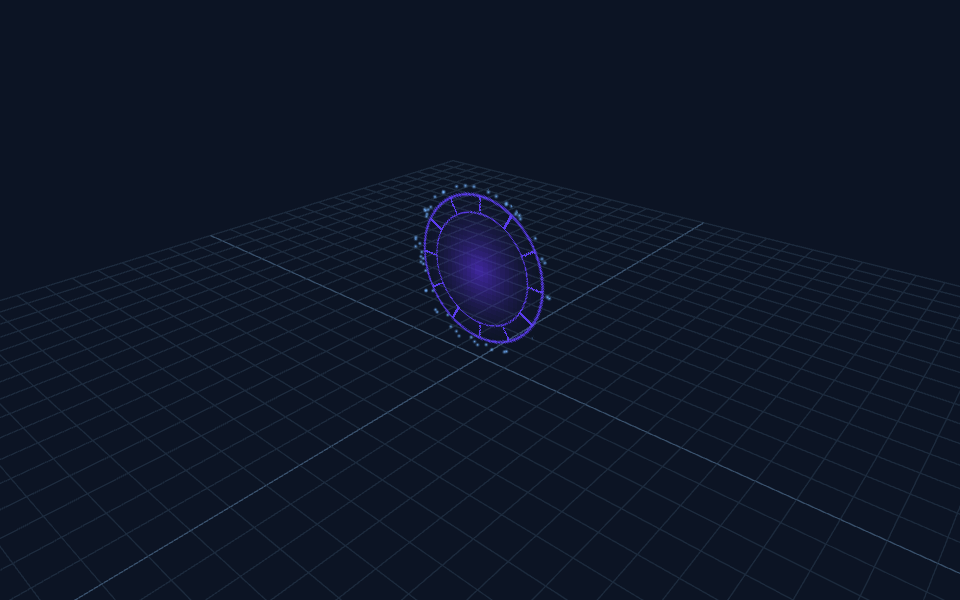
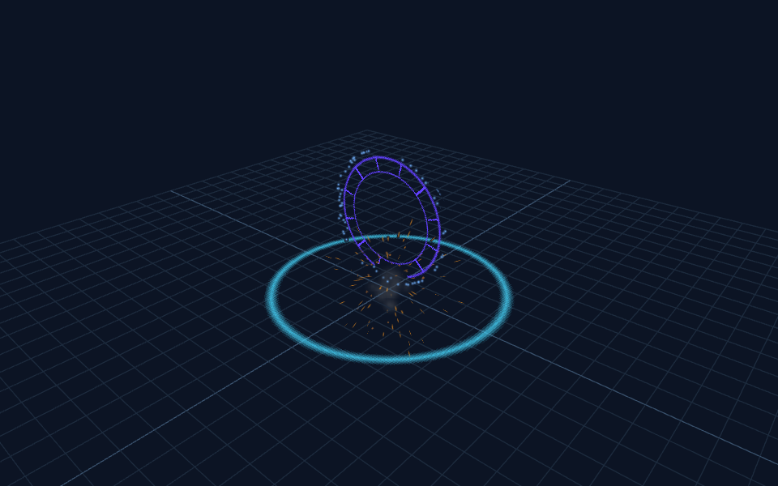
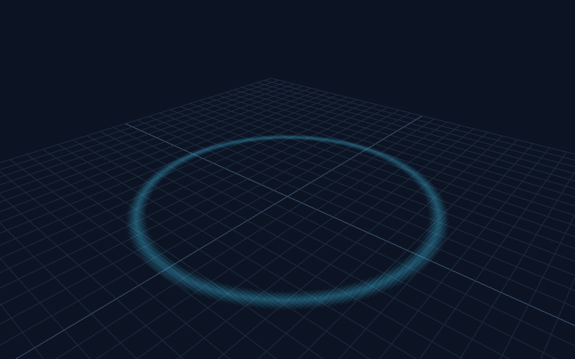
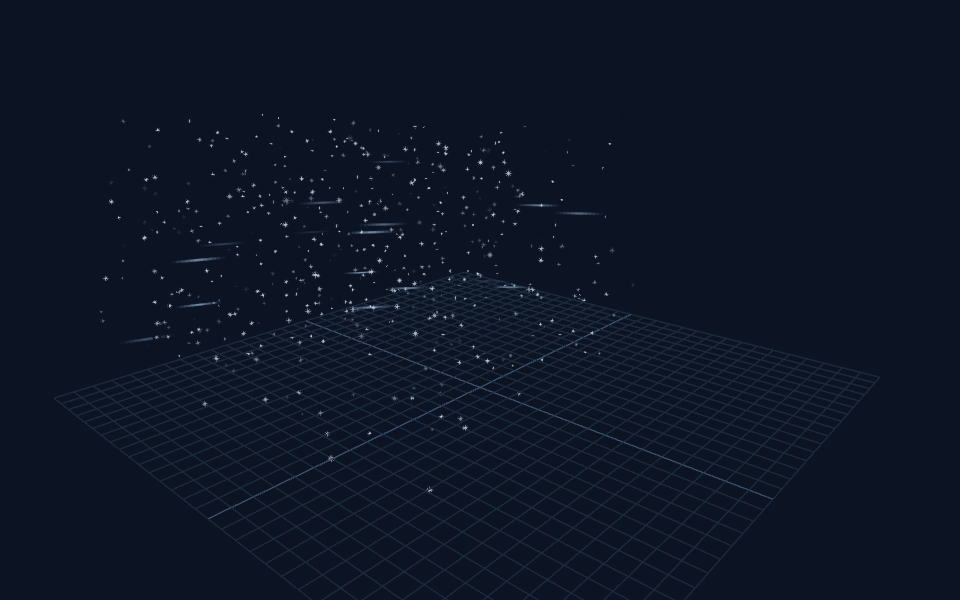

# Particle Jester — MCBE Particle Master AI

[](https://github.com/dotmcworld/particle-jester/actions/workflows/check.yml)
[](LICENSE)

This is the public GitHub edition. The detailed private source catalog is excluded; all original tools, effects, pattern recipes and reviewed previews are included. Scan your own licensed packs to build a local catalog. See [publishing instructions](PUBLISHING.md).

A working Codex particle engineering repository: one Codex skill with 11 engineering capabilities, a Node CLI, a source/PNG dependency catalog, original VFX packs, deterministic checks, a local Wintersky preview studio and MCP bridge, and executable evaluations.

Research inspected **1,575 files, 856 particles and 417 PNGs**. The private source catalog and raw source assets are excluded from this public repository. The original sample pack has 18 particle definitions and eight generated textures, with portal, blizzard, explosion and boss sequences plus a particle-event cinematic.

## Particle samples

[Download the sample add-on](https://github.com/dotmcworld/particle-jester/releases) or browse the [editable example packs](examples/original-vfx). The [sample gallery and command guide](examples/original-vfx/SHOWCASE.md) covers portals, shockwaves, snowstorms, explosions, beams, lightning, flames and more.

| Portal | Boss sequence |
| --- | --- |
|  |  |
| Shockwave | Blizzard |
|  |  |

These are captured Wintersky previews of the actual sample definitions. Minecraft runtime verification remains pending. Sample target: Bedrock 1.26.50 and stable `@minecraft/server` 2.9.0; verify your installed game/API compatibility before enabling the script driver.

Example requests for Codex after installation:

> Use $particle-jester to create a violet portal with orbiting sparks and a closing flash.
>
> Use $particle-jester to debug this particle's missing texture and verify its atlas frames.
>
> Use $particle-jester to make a cheaper mobile variant of this blizzard and compare the previews.

## Start

```powershell
git clone https://github.com/dotmcworld/particle-jester.git
cd particle-jester
npm ci
npm run check
npm run typecheck
npm run studio
```

Open `http://127.0.0.1:47833` for orbit controls, effect selection, time scrubbing and PNG export. Headless capture uses installed Edge/Chrome, `PARTICLE_BROWSER`, or Playwright's Chromium. If none is installed, run `npx playwright install chromium`.

```powershell
node tools/cli.mjs scan examples/original-vfx/RP --external variable.quality --bounds config/parameters.json --out work/catalog.json --report work/inspection.md --strict
node tools/cli.mjs search work/catalog.json shockwave
node tools/cli.mjs trace work/catalog.json pm:shockwave
node tools/preview.mjs --effect pm:shockwave --out work/shockwave
node tools/preview.mjs --sequence examples/original-vfx/sequences.json --name portal --times 0.1,1,2,4.1 --out work/portal
node tools/cli.mjs package examples/original-vfx/RP work/particle-master-vfx.mcpack
```

See [CLI commands](references/tooling.md), [setup/install](references/setup.md), [troubleshooting](references/troubleshooting.md) and the [worked shockwave demonstration](examples/original-vfx/DEMONSTRATION.md). This is retrieval and tooling for Codex; it does not fine-tune a model or prove expert performance by itself.

All 11 original capabilities now belong to the single **Particle Jester** skill. Invoke `$particle-jester`; focused supporting mode guides keep specialist knowledge available without registering eleven separate skills. Keep the full checkout for the shared tools. For GitHub, use the public export described in [publishing instructions](PUBLISHING.md).

## Install skills and connect MCP

```powershell
node scripts/install-skills.mjs --apply
node scripts/mcp-smoke.mjs
```

The installer copies Particle Jester and its supporting mode guides into `%CODEX_HOME%/skills` (or `%USERPROFILE%/.codex/skills`) with absolute links to this checkout's shared resources. It refuses to overwrite differing skills unless `--replace` is supplied. Keep the repository at its installed path, or reinstall after moving it. The skill helper prints the actual repository location. Skill installation alone does not edit unrelated Codex settings.

Use the entries in `config/mcp.example.toml` for this repository's stdio bridge, Blockbench's verified tool family, or Playwright MCP. Replace the documented paths, then reload the client. The stdio smoke test proves local initialization and actual tool calls; a configuration example alone is not a connected server. Blockbench must be open with its plugin running. No Minecraft-particle Snowstorm MCP was established during the research.

## Verification

Automated results are in `evidence/evaluation.json`. Render captures and manual inspection reports are in `evidence/demo` and `evidence/previews`. In-game testing remains pending. Preview renders approximate Bedrock; they do not establish engine collision, lighting, actor attachment, query availability, multiplayer visibility or hardware budgets.

The independent schema checks documented component names and important field shapes, but it is intentionally conservative and is not Mojang's full engine validator. Unsupported MoLang contexts and dynamic bounds remain visible. See [coverage and limits](references/tooling.md).

## Provenance and licenses

Architecture was studied from [mcbejsonuimasterAI](https://github.com/boredape874/mcbejsonuimasterAI). Particle contracts were cross-checked with [Microsoft's component references](https://learn.microsoft.com/en-us/minecraft/creator/reference/content/particlesreference/particlecomponentlist?view=minecraft-bedrock-stable) and [pinned Mojang samples](https://github.com/Mojang/bedrock-samples/tree/46ba6ea985fb5a92d79a9419198f10dda14c199d/resource_pack/particles). The preview uses [Wintersky's documented interface](https://github.com/JannisX11/wintersky), also used by Snowstorm. See `config/research-lock.json`, `references/source-index/architecture.md` and `THIRD_PARTY_NOTICES.md`.

Repository code, documentation and generated example assets are licensed under MIT. Upstream examples retain their own terms; source-pack metadata is not a license grant. For a public archive, use `node scripts/export.mjs --public` to exclude local-use evidence.
