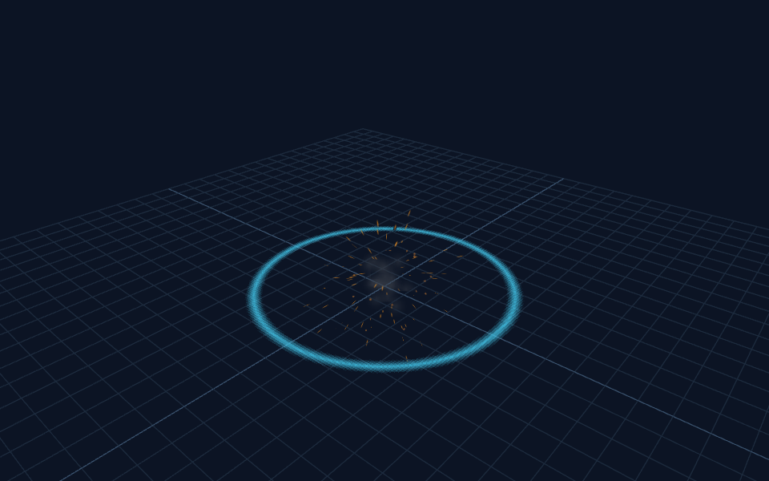

# Particle Jester sample gallery

These original MIT sample effects were built alongside Particle Jester's engineering tools. All particle JSON, textures and the optional script driver are editable. Images below are saved Wintersky renders, not Minecraft screenshots. In-game verification is pending.

## Download and try

Download `particle-master-vfx.mcaddon` from the [GitHub release](https://github.com/dotmcworld/particle-jester/releases), open it with Minecraft Bedrock, and activate the resource pack in a test world. Activate the behavior pack as well to try the scripted sequences. The manifests target Bedrock 1.26.50; the script driver requires stable `@minecraft/server` 2.9.0. Check compatibility with your installed game before importing.

Enable cheats for the example commands. Run the script events from your player chat so they have an entity source; server-console events with no entity source are ignored by the driver.

```text
/particle pm:shockwave ~ ~1 ~
/particle pm:cinematic ~ ~1 ~
/scriptevent pm:vfx portal
/scriptevent pm:vfx blizzard
/scriptevent pm:vfx explosion
/scriptevent pm:vfx boss
```

The script sequences snapshot the player's origin and prevent overlapping jobs for the same owner. They are visual demonstrations and do not deal damage. See [pack details](README.md) and the [shockwave correction walkthrough](DEMONSTRATION.md).

## Layered examples

| Effect | Preview | What it demonstrates |
| --- | --- | --- |
| Portal |  | Rune frame, translucent core and orbiting motes. |
| Boss sequence |  | Timed portal, lightning, shockwave, sparks, debris and smoke. |
| Blizzard |  | Flakes and wind streaks with independently controlled density. |
| Explosion |  | Ground impact, sparks, debris and smoke with separate tails. |
| Shockwave |  | Expanding annulus, corrected visible radius and opacity fade. |

## Every particle ID

With the resource pack active, use `/particle <id> ~ ~1 ~` to try a standalone effect.

| ID | Example |
| --- | --- |
| `pm:shockwave` | Expanding ground ring |
| `pm:portal_ring` | Rotating portal rune |
| `pm:portal_core` | Portal center |
| `pm:portal_motes` | Orbiting sparks |
| `pm:blizzard_snow` | Snowflakes |
| `pm:blizzard_gust` | Wind streaks |
| `pm:explosion_sparks` | Impact sparks |
| `pm:explosion_smoke` | Fading smoke |
| `pm:debris` | Debris burst |
| `pm:cinematic` | Event-chained impact timeline |
| `pm:vortex` | Spiral motion |
| `pm:beam` | Planar beam study |
| `pm:lightning` | Planar lightning study |
| `pm:trail` | Trail study |
| `pm:slash` | Planar slash study |
| `pm:flame` | Eight-frame flame atlas |
| `pm:water` | Water spray |
| `pm:dust` | Dust cloud |

Beam, lightning and slash samples demonstrate visual formulas; arbitrary endpoint targeting and sword attachments need additional integration. Preview results cannot establish game collision, query behavior, multiplayer visibility or device performance.

## Edit and preview locally

From the full repository checkout, run `npm ci` and `npm run studio`, then open `http://127.0.0.1:47833`. Select a particle, orbit the camera and scrub time. For automated captures, use the CLI commands in the [main README](../../README.md). Run `npm run check`, `npm run typecheck` and `npm run package:examples` after changes. Asset changes require new captures and visual inspection before retaining preview approval.
